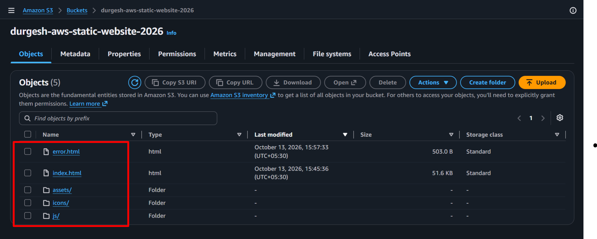
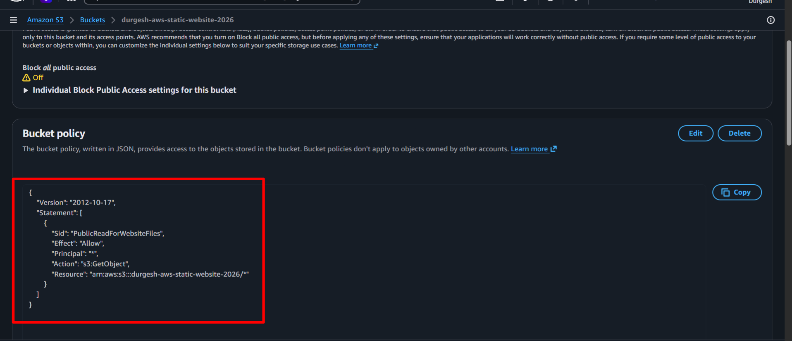
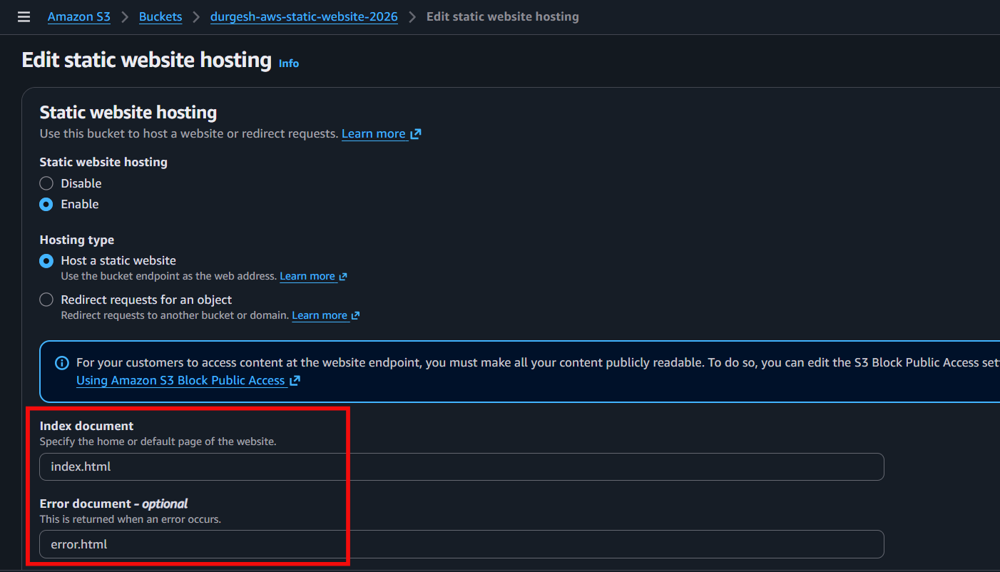
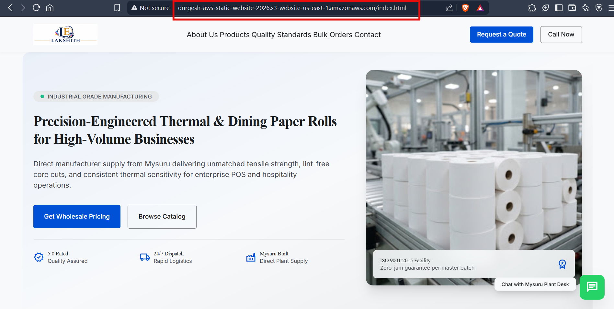

# Static Website Hosting on Amazon S3

This is my first AWS project. I hosted a sample business website using
Amazon S3 as part of my AWS learning journey.

## Services Used

-   Amazon S3
-   HTML
-   CSS
-   JavaScript

## What I Did

-   Created an S3 bucket.
-   Uploaded the website files and assets.
-   Enabled static website hosting.
-   Configured a bucket policy for public read access.
-   Added a custom error page.
-   Tested the live website and fixed the missing `index.html` issue.

## Screenshots

### S3 Bucket

### Bucket Policy

### Static Website Hosting Settings

### Live Website

## Live Website

[View live Website](http://durgesh-aws-static-website-2026.s3-website-us-east-1.amazonaws.com).

Note: This website is hosted using the AWS Free Tier for learning
purposes. The live link may not always be available when you visit it,
as the AWS resources or hosting configuration may change while I
continue learning. If the link does not work, please refer to the
screenshots above to see the website and its AWS configuration.
## What I Learned

I learned how to host a static website on Amazon S3, configure bucket
permissions, and troubleshoot website access and file path issues.

## Author

Durgesh Gowda H B

[GitHub Profile](https://github.com/durgesh-hb)
