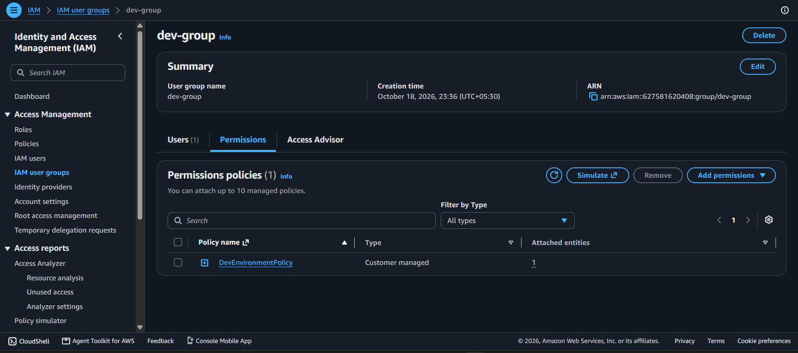
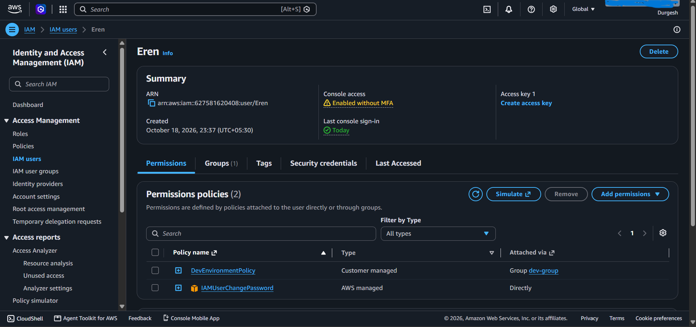
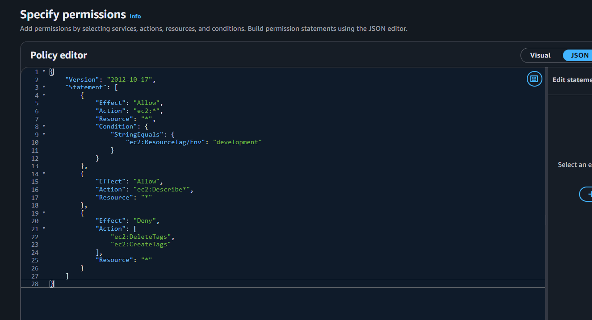
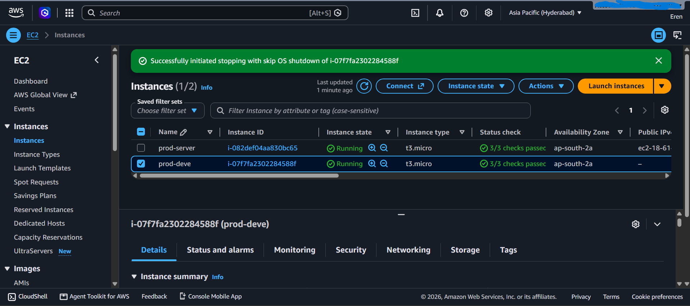
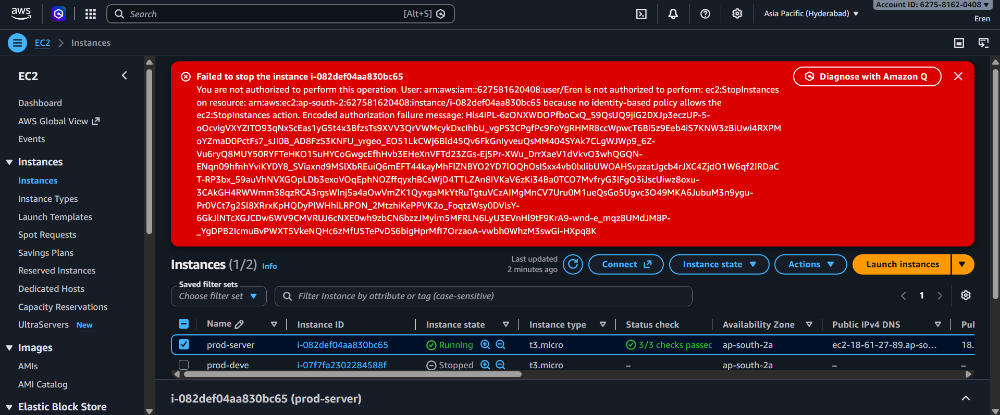
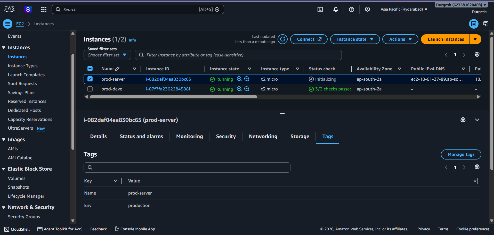
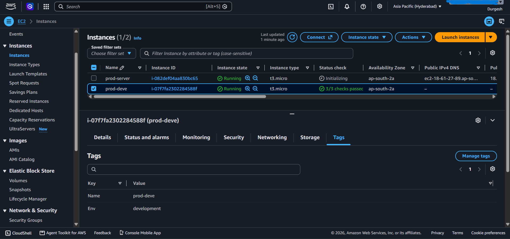

# AWS IAM Cloud Security Lab

## Project Overview

This project demonstrates how to control access to AWS resources using **AWS Identity and Access Management (IAM)**.

The goal is to allow developers to manage development EC2 instances while preventing unauthorized actions on production resources.

## AWS Services Used

- AWS IAM
- Amazon EC2
- Amazon VPC
- EC2 Resource Tags

## Architecture

(screenshots/architecture.png)

## Resources Created

| Resource | Name / Configuration |
|---|---|
| IAM User | `Eren` |
| IAM Group | `dev-group` |
| IAM Policy | `DevEnvironmentPolicy` |
| Development Tag | `Env=development` |
| Production Tag | `Env=production` |

## IAM Policy Overview

The policy contains three main permission rules:

1. **Allow development access:** Permits specified EC2 actions on development-tagged resources where resource-level permissions and conditions are supported.
2. **Allow Describe operations:** Permits specified EC2 read and discovery operations.
3. **Explicit Deny for tag changes:** Blocks the specified EC2 tag-creation or tag-deletion actions.

An explicit Deny takes precedence over an applicable Allow. Actual permissions depend on the policy's actions, resources, and conditions.

## Screenshots

Store the screenshots in a folder named `screenshots/` in the repository.

### 1. IAM Group

### 2. IAM User Permissions

### 3. IAM Policy JSON

### 4. Development Instance Stop Test

### 5. Production Instance Access Denied

### 6. Production Instance Tags

### 7. Development Instance Tags

> **Note:** Replace the example image filenames with your actual screenshot filenames.

## Testing Results

| Test | Expected Result | Result |
|---|---|---|
| View both EC2 instances | Allowed | Passed |
| Stop development instance | Allowed | Passed |
| Stop production instance | Denied | Passed |
| Create a new tag | Denied | Passed |

## Project Status

**IAM policy configuration and permission tests completed.**