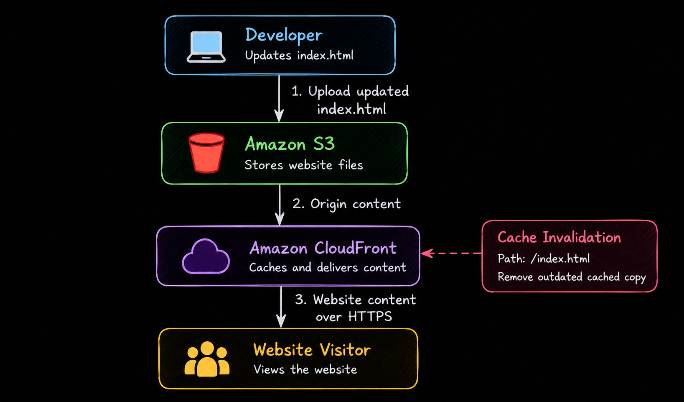
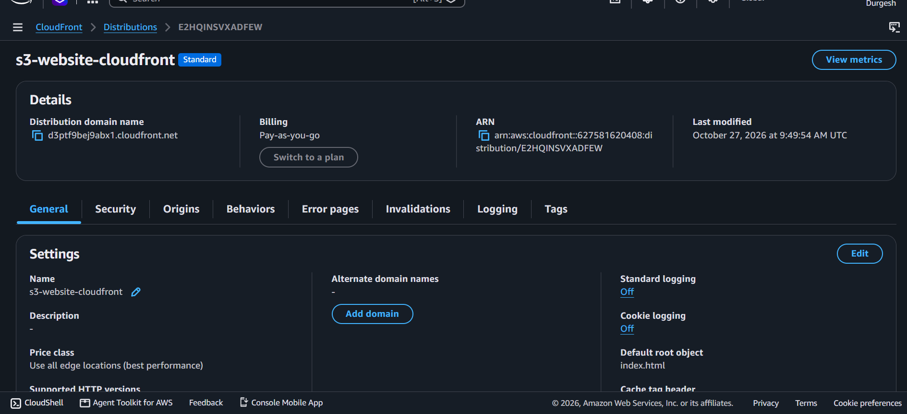
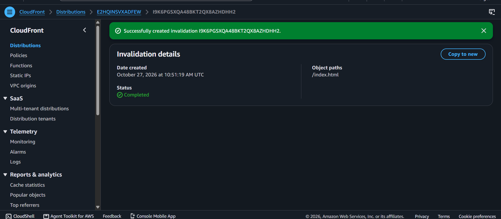
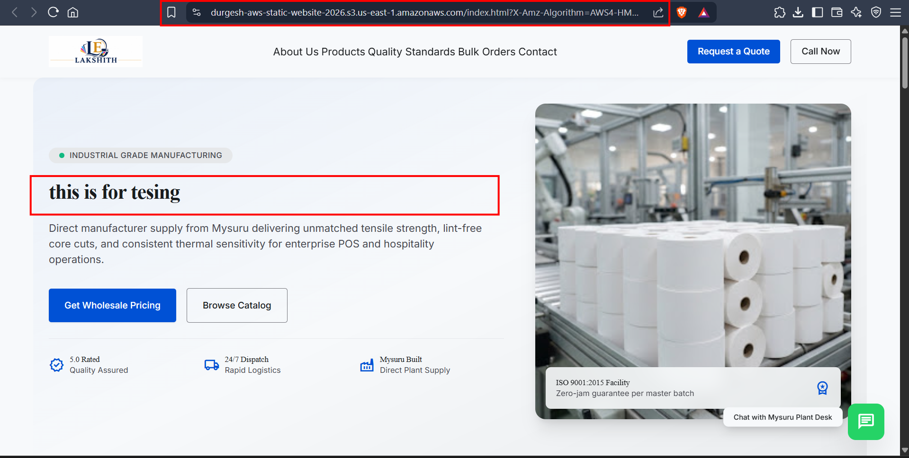
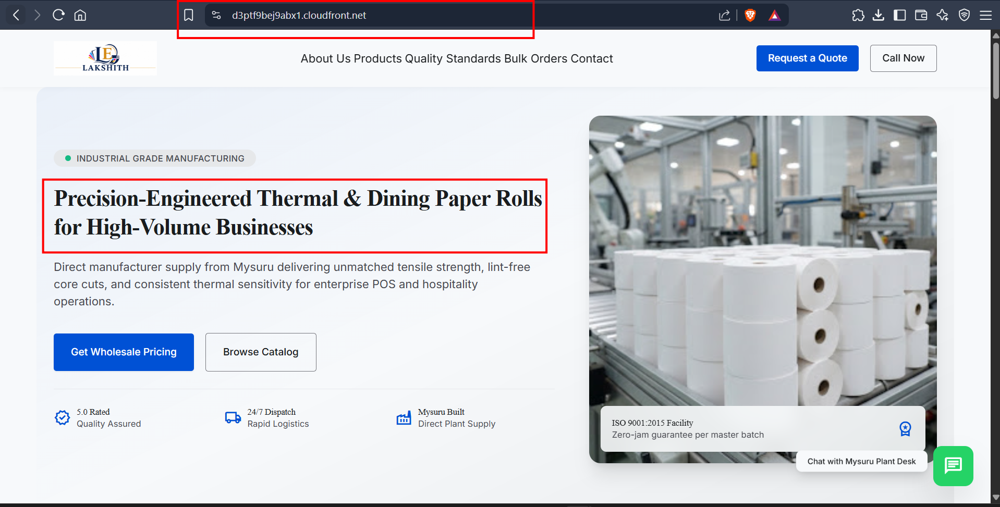

# AWS S3 Static Website Hosting with CloudFront

## Project Overview

This project demonstrates how to host a static website using Amazon S3 and deliver website content globally using Amazon CloudFront.

I also learned how to update website files in S3 and invalidate the CloudFront cache when the website displays outdated content.

## AWS Services Used

- Amazon S3
- Amazon CloudFront

## Architecture

## Implementation Steps

### 1. Create an S3 Bucket

- Created an S3 bucket named `durgesh-aws-static-website-2026`.
- Uploaded the static website files.
- Stored `index.html` in the bucket root.

### 2. Configure CloudFront

- Created a CloudFront distribution named `s3-website-cloudfront`.
- Configured `index.html` as the default root object.
- Accessed the website using the CloudFront distribution domain name.

### 3. Update the Website

- Modified the heading in the local `index.html` file.
- Uploaded the updated file to the same S3 bucket using the same object key.
- Verified that S3 contained the updated content.

**Note:** An existing S3 object can be replaced by uploading a new file with the same object key. Deleting the original file first is not necessary.

### 4. Fix the CloudFront Cache

After updating the file in S3, CloudFront continued displaying the previous heading because the old content was cached.

To fix this:

1. Opened the CloudFront distribution in the AWS Console.
2. Navigated to **Invalidations**.
3. Created an invalidation for `/index.html`.
4. Waited for the invalidation status to become `Completed`.
5. Refreshed the website and verified the updated content.

## Screenshots

Store your screenshots in the `screenshots/` folder in the repository.

### 1. CloudFront Distribution

### 2. Cache Invalidation Completed

### 3. Updated Website on S3

### 4. CloudFront Website Before Invalidation

> **Note:** Replace the example screenshot filenames with your actual image filenames.

## What I Learned

- How CloudFront distributes content to website visitors.
- How to update an existing S3 object.
- Why CloudFront may serve cached content after an update.
- How to create a CloudFront cache invalidation.
- How S3 and CloudFront work together to deliver website content.
