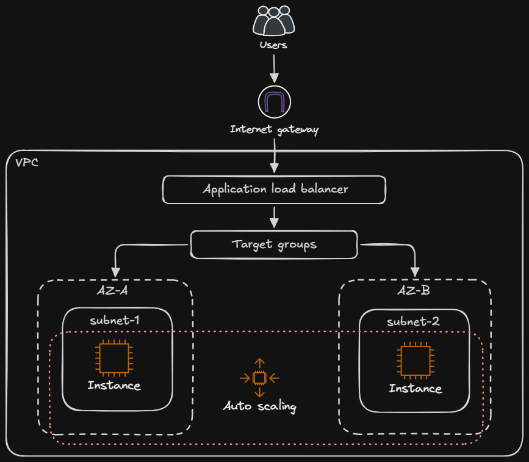
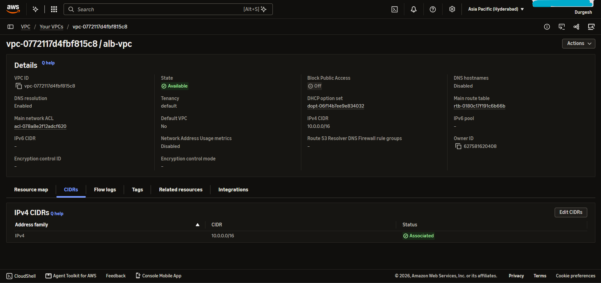
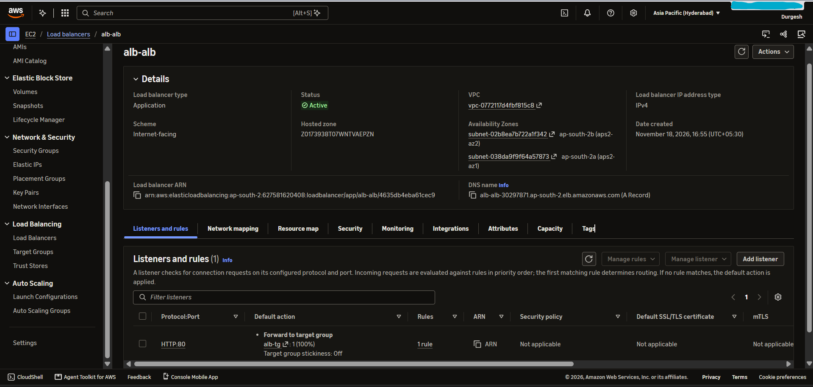
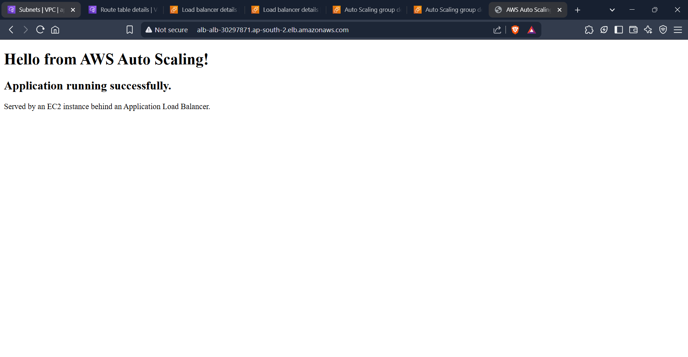
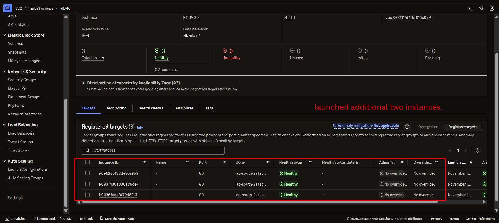
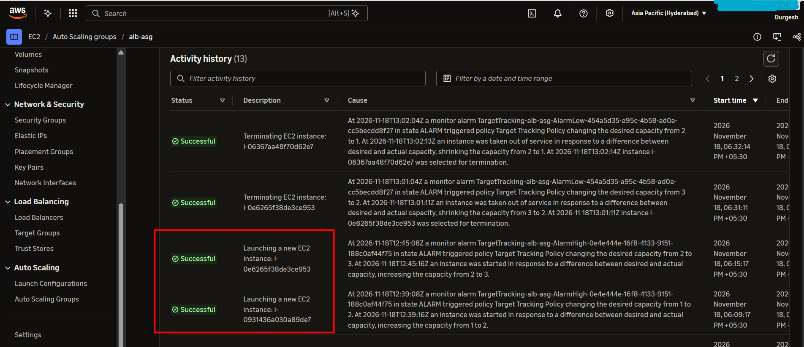
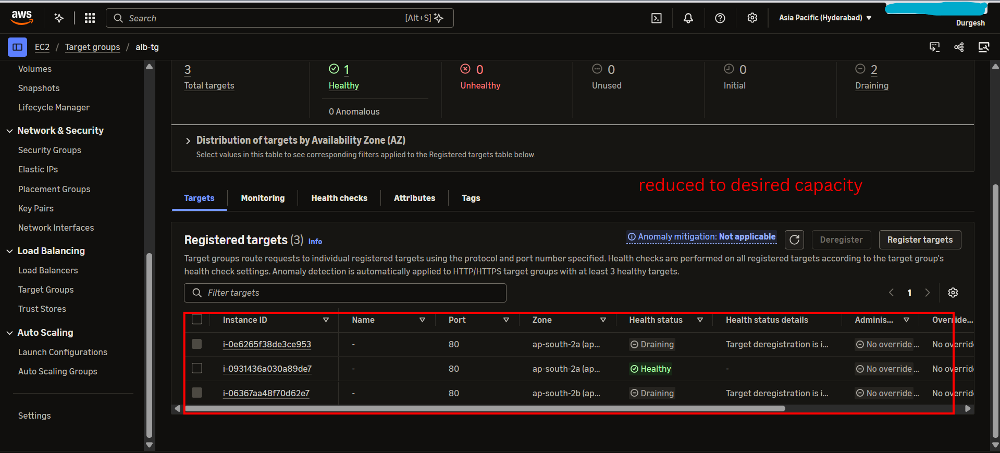
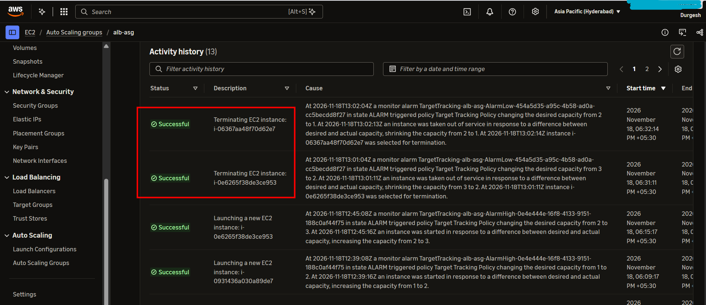

# Highly Available Web Application using AWS ALB and Auto Scaling

## Project Overview

In this project, I built and deployed a web application on AWS using an Application Load Balancer and an Auto Scaling Group.

The application runs on Amazon EC2 instances. The Load Balancer distributes incoming traffic, while Auto Scaling automatically increases or decreases the number of instances based on CPU utilization.

## AWS Services Used

- Amazon VPC
- Amazon EC2
- Application Load Balancer (ALB)
- Target Groups
- Auto Scaling Group (ASG)
- Launch Template
- Amazon CloudWatch
- AWS Systems Manager

## Architecture



## Implementation Steps

### 1. Create VPC and Networking

- Created a custom VPC named `alb-vpc` with CIDR `10.0.0.0/16`.
- Created two public subnets in different Availability Zones.
- Attached an Internet Gateway.
- Configured route tables to allow internet connectivity.




### 2. Configure Security Groups

Created two security groups:

- **ALB Security Group:** Allows HTTP traffic on port 80 from the internet.
- **EC2 Security Group:** Allows HTTP traffic on port 80 only from the ALB security group.

### 3. Create EC2 Launch Template

Created a Launch Template named `alb-LT` with:

- Amazon Linux 2023
- Instance type: `t3.micro`
- Storage: 8 GB gp3
- EC2 security group
- IAM instance profile for Systems Manager

Configured User Data to automatically install Apache HTTP Server and create a simple HTML webpage when an EC2 instance launches.

### 4. Create Target Group

Created a target group named `alb-tg`.

- Target type: Instances
- Protocol: HTTP
- Port: 80
- Health check path: `/`

The target group checks whether EC2 instances are healthy and ready to receive traffic.

### 5. Create Application Load Balancer

Created an internet-facing Application Load Balancer named `alb-alb`.

- Configured it across both public subnets.
- Added an HTTP listener on port 80.
- Connected the listener to `alb-tg`.

The ALB receives user requests and forwards them to healthy EC2 instances.



### 6. Create Auto Scaling Group

Created an Auto Scaling Group named `alb-asg` using the Launch Template.

Configuration:

| Setting | Value |
|---|---|
| Minimum capacity | 1 |
| Desired capacity | 1 |
| Maximum capacity | 3 |
| Availability Zones | 2 |
| Health checks | EC2 and ELB |

Connected the Auto Scaling Group to the target group so newly launched instances are automatically registered.

### 7. Configure Target Tracking Scaling

Created a target tracking scaling policy using average CPU utilization.

- Target CPU utilization: 50%
- Instance warmup: 300 seconds
- Scale-in: Enabled

CloudWatch monitors CPU utilization and the Auto Scaling Group adjusts the number of EC2 instances automatically.

## Application Testing

Opened the Application Load Balancer DNS name in a browser and verified that the Apache-hosted HTML webpage was working.



## Auto Scaling Testing

To verify automatic scaling, I connected to an EC2 instance using **AWS Systems Manager Session Manager** and generated CPU load using `stress-ng`.

###  Install stress-ng

```bash
sudo dnf install -y stress-ng
```

###  Generate CPU Load

```bash
cd /tmp
stress-ng --cpu 2 --cpu-load 80 --timeout 600s
```

This command generates approximately 80% CPU load using 2 CPU workers for 600 seconds (10 minutes).

###  Scale-out Test

When CPU utilization increased, the CloudWatch alarm triggered the target tracking scaling policy. The Auto Scaling Group automatically launched additional EC2 instances.

**Observed Capacity:**

```text
1 → 2 → 3 EC2 instances
```



The following screenshots show the additional targets becoming healthy and the scaling activities recorded by AWS.

###  Scale-in Test

After CPU utilization decreased, the target tracking policy automatically reduced the desired capacity of the Auto Scaling Group.

**Observed Capacity:**

```text
3 → 2 → 1 EC2 instance
```



The Activity History confirms the scale-in operations. The final Auto Scaling Group state showed one healthy EC2 instance.

### Verification

Verified both scale-out and scale-in operations through:

- Auto Scaling Group Activity History.
- CloudWatch target tracking alarms.
- Target Group health status.
- Auto Scaling Group desired capacity and instance health.

## Final Result

Successfully deployed a web application using an Application Load Balancer and Auto Scaling Group.

- Application accessible through the ALB DNS name.
- Traffic forwarded to healthy EC2 instances.
- EC2 instances deployed across two Availability Zones.
- Automatic scale-out tested successfully.
- Automatic scale-in tested successfully.
- Final Auto Scaling Group capacity returned to one instance.

## What I Learned

- VPC and subnet configuration.
- Application Load Balancer and target groups.
- EC2 Launch Templates and User Data.
- Auto Scaling Group configuration.
- CloudWatch monitoring and target tracking policies.
- Automatic scale-out and scale-in.
- Troubleshooting EC2 health checks and connectivity.

## Future Improvements

- Deploy my personal portfolio website instead of the test HTML page.
- Configure HTTPS using AWS Certificate Manager.
- Connect a custom domain using Route 53.
- Explore private subnet deployment.

## Author

**Durgesh Gowda HB**

[GitHub](https://github.com/DurgeshGowda-HB)